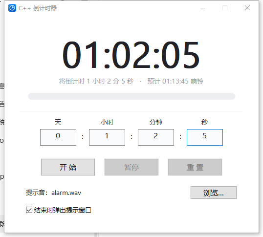

# C++ 倒计时器

一个用 C++ / Win32 API 写的倒计时小程序，包含**图形界面版**和**控制台版**，可执行文件已经编译好，双击即用。



---

## 直接使用

| 文件 | 说明 |
|------|------|
| `countdown_gui.exe` | **图形界面版**（推荐） |
| `countdown.exe` | 控制台版 |
| `alarm.wav` | 默认提示音 |
| `timer.ini` | 配置文件（声音、弹窗文字等） |
| `app.ico` / `app.rc` | 程序图标及其资源脚本 |

---

## 图形界面版

### 功能

- **天 / 小时 / 分钟 / 秒** 四个输入框，想设多久设多久
- 大号数字显示剩余时间 + 进度条 + 百分比
- **实时显示目标响铃时间**：输入时长时立刻显示「预计 明天 08:30:00 响铃」，跨天自动加「明天 / 后天」
- 开始 / 暂停 / 重置，进度条实时推进
- 时间到：**自定义声音** + **弹窗提示** + 任务栏闪烁
- **托盘**：关闭或最小化窗口时自动收进系统托盘，双击图标恢复
- 托盘右键菜单可切换「关闭窗口时最小化到托盘」，也可以选择直接退出

### 操作

| 操作 | 效果 |
|------|------|
| 点「开始」或按空格 | 开始倒计时 |
| 按空格 | 暂停 / 继续 |
| 点「浏览...」 | 选择自己的提示音（`.wav` / `.mp3`） |
| 点窗口右上角 × | 收进托盘（默认行为，可在托盘菜单改） |
| 双击托盘图标 | 重新打开窗口 |
| 托盘图标右键 | 显示窗口 / 开始暂停 / 重置 / 关闭行为 / 退出 |
| Esc | 收进托盘 |

> 提示：Windows 11 会把新程序的托盘图标放进「^」折叠区，可以把它拖到任务栏上固定显示。

---

## 控制台版

```bat
countdown.exe                     交互式输入时长
countdown.exe 0 1 30 0            0天1小时30分0秒
countdown.exe 01:30:00            时:分:秒
countdown.exe 90                  90 秒
```

运行时：**空格** 暂停/继续，**Esc** 退出。界面上有 5 行高的大号数字、进度条、预计结束时间。

命令行选项：

```bat
-s, --sound <文件>     指定提示音（.wav / .mp3）
-t, --title <文字>     弹窗标题
-m, --message <文字>   弹窗内容，{time} 会替换为总时长
-n, --no-loop          提示音只播放一次
-q, --no-popup         不弹窗
    --no-flash         不闪烁任务栏
    --no-sound         不播放声音
-h, --help             显示帮助
```

---

## 配置文件 `timer.ini`

两个版本共用同一份配置（放在 exe 同目录）：

```ini
# 提示音：文件路径 / 系统声音别名 / 留空=系统默认
sound = alarm.wav
# 是否循环播放
loop = true
# 是否额外响一声系统提示音
beep = false

# 弹窗
popup = true
title = 倒计时结束
message = 时间到！\n\n倒计时 {time} 已经结束。
# 结束时是否闪烁任务栏
flash = true
```

`{time}` 会自动替换成本次倒计时的总时长，`\n` 表示换行。

---

## 自己编译

需要 Visual Studio（或 Build Tools）的 C++ 编译工具。

```bat
build_gui.bat      编译图形界面版
build.bat          编译控制台版
```

或者手动：

```bat
rem 先编译图标资源，再链接进 exe
rc /nologo /fo app.res app.rc

cl /utf-8 /EHsc /O2 /std:c++17 countdown_gui.cpp app.res /Fe:countdown_gui.exe ^
   /link user32.lib gdi32.lib winmm.lib comdlg32.lib shell32.lib advapi32.lib /SUBSYSTEM:WINDOWS

cl /utf-8 /EHsc /O2 /std:c++17 countdown.cpp /Fe:countdown.exe /link winmm.lib user32.lib
```

> 源码是 UTF-8 编码，务必带 `/utf-8` 编译，否则中文字符串会乱码。

---

## 说明

- 纯 Win32 API + GDI，没有任何第三方依赖，单个 exe 即可运行
- **程序图标**：`app.ico` 含 16/24/32/48/64/128/256 七个尺寸，通过 `app.rc` 编进 exe，资源管理器、任务栏、窗口标题栏、托盘统一使用；程序启动时用 `LoadImage` 按当前 DPI 加载对应尺寸，缩放不模糊
- 声音播放：`.wav` 用 `PlaySound`，`.mp3` 等用 MCI，系统别名（如 `SystemExclamation`）也支持
- 「关闭时最小化到托盘」的偏好保存在注册表 `HKEY_CURRENT_USER\Software\CppCountdown`
- 窗口支持高 DPI，125% / 150% 缩放下不会模糊
